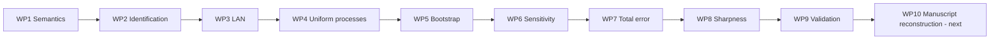

# Causal SPDE Research Programme - Status after WP9

## Current position

The project has completed WP1-WP9. All theorem, inferential, approximation, sharpness, and validation packages are closed.

## WP9 completion

WP9 now supplies:

1. a theorem-aligned high-replication heat-equation experiment;
2. a formal audit of the original design grid;
3. mixed-rate LAN and likelihood-ratio diagnostics;
4. CDF, quantile, tail and effect error summaries;
5. pointwise and simultaneous coverage;
6. multiplier, draw-count and grid-resolution sensitivity;
7. Galerkin slope estimates with confidence intervals;
8. temporal and total-error validation;
9. bounded-operator response checks;
10. exact non-identification demonstrations;
11. raw results, environment capture, Git provenance and checksums;
12. verified one-command execution.

## Remaining package

Only WP10 remains. It should reconstruct the manuscript around the completed theorem chain and use the WP9 report as the simulation and computational appendix.
